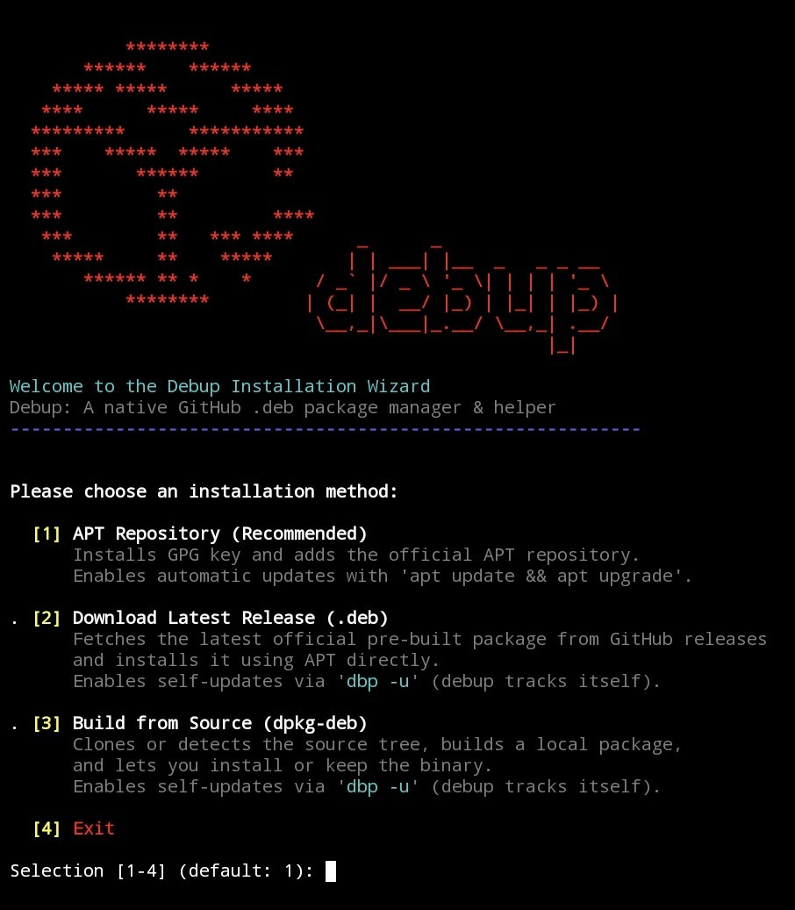

<div align="center">
 

<h1>debup</h1>
<p><strong>debup - Gestor de paquetes híbrido: el puente que faltaba entre GitHub & APT para distribuciones basadas en Debian/Ubuntu, Raspberry Pi, Docker, WSL & Terminal Linux Android (AVF).</strong></p>
<p>Busca, descubre, rastrea, instala y actualiza paquetes <code>.deb</code> directamente desde APT & GitHub Releases <strong>simultáneamente</strong>.</p>
<p><em>Sin PPAs, sin sandboxes pesados, sin repositorios de terceros — solo binarios <code>.deb</code> nativos obtenidos directamente del upstream.
Instalación fácil con el <a href="https://github.com/Ruraam/debup#-installation">instalador Debup interactivo/no-interactivo</a>.</em></p>
  
</div>

<br/>

<div align="center">
<a href="LICENSE"></a> &nbsp;
<a href="https://debian.org"></a> &nbsp;
<a href="#"></a> &nbsp;
<a href="https://www.gnu.org/software/bash/"></a>
</div>

<div align="center">
<a href="https://github.com/Ruraam/debup/releases"></a> &nbsp;
<a href="#"></a> &nbsp;
<a href="https://github.com/Ruraam/debup/releases"></a>
</div>

<br/>

<div align="center">

<a href="README.md"> English</a> &nbsp;•&nbsp;
<a href="README.fr.md"> Français</a> &nbsp;•&nbsp;
<a href="README.es.md"> Español</a>

</div>

<div align="center">

| [Uso](https://github.com/Ruraam/debup/tree/main#%EF%B8%8F-uso) | [Token GitHub](https://github.com/Ruraam/debup/blob/main/README.es.md#-configurar-un-token-de-github-opcional--dbp-token-) | [Búsqueda & Instalación](https://github.com/Ruraam/debup/tree/main#-descubrimiento-búsqueda--instalación-de-paquetes--dbp-search) | [Desinstalación](https://github.com/Ruraam/debup/tree/main#%EF%B8%8F-desinstalación) |
| :---: | :---: | :---: | :---: |
| [Configuración](https://github.com/Ruraam/debup/blob/main/README.es.md#%EF%B8%8F-configuración) | [Capturas de pantalla](https://github.com/Ruraam/debup/tree/main#capturas-de-pantalla) | [Changelog](https://github.com/Ruraam/debup/releases) | [Licencia](LICENSE) |
</div>

---
> 🚀 **Descubre mi nuevo proyecto:** [**ULPM & .lpk**](https://github.com/Ruraam/ulpm) — *Gestor de paquetes contenedorizado ligero, sin root, sin demonio para Linux.*

---

##  debup [ `dbp` ] - El puente que faltaba entre GitHub & APT

¿Echas de menos la comodidad de AUR en Debian/Ubuntu? **debup** convierte GitHub Releases en tu repositorio personal de terceros.
**Descubre, inspecciona, instala y actualiza paquetes Debian directamente desde GitHub Releases con la simplicidad de `apt`.**

## ✨ Funciones clave

### 🔍 Descubrimiento unificado & instalación múltiple [dbp -s <consulta>] :

• Busca simultáneamente en repositorios APT Debian y GitHub Releases desde una sola consulta en terminal, pre-filtrada para binarios compatibles.

• Prompt interactivo de selección múltiple compatible con rangos y listas separadas por comas (ej. 1 2 3, 1-3, 1,2,4) para instalaciones por lotes rápidas.

• Cada resultado de GitHub conserva el ID exacto de su release y el nombre del `.deb` compatible mostrado. La instalación vuelve a validar esa misma release y ese mismo asset en lugar de resolver silenciosamente otra release `latest`.

• El catálogo integrado solo incluye fuentes GitHub Releases que debup puede validar y rastrear. Se excluyen las descargas directas hasta que su integridad y seguimiento de actualizaciones estén completamente implementados.

#### 📦 Instalación directa [dbp -i <owner/repo> / dbp -i <paquete>]:

• Ya no necesitas rastrear URLs de release. Apunta a cualquier repositorio, y debup detecta, empareja tu arquitectura (amd64 / arm64), descarga e instala el .deb correcto.

• Funciona también de forma transparente con paquetes APT nativos (dbp -i bat).

• Soporta fijación de versión al instalar: dbp -i owner/repo@vX.Y.Z.

• Soporta instalaciones automatizadas no interactivas vía -y / --yes.

#### ℹ️ Vista previa de metadatos [dbp -f <owner/repo>]:

• Previsualiza metadatos remotos antes de tocar tu sistema (número de estrellas, licencia SPDX, descripción, tag de release, fecha de publicación y compatibilidad de arquitectura de los assets).

#### 🛡️ Auditoría de seguridad & inspección de scripts root [dbp -I <owner/repo>]:

• Inspecciona los scripts internos del mantenedor (preinst, postinst, prerm, postrm) y el árbol de archivos crudo contenido dentro de cualquier .deb remoto antes de su ejecución.

• Prompt interactivo automático que te alerta siempre que un paquete descargado contiene scripts de mantenimiento root antes de la instalación.

#### 🔒 Verificación de integridad automatizada:

• Detecta y valida automáticamente los archivos de checksums publicados (SHA256SUMS, checksums.txt, *.sha256) contra los binarios descargados antes de invocar dpkg.

#### 🔄 Ciclo de vida APT nativo & actualizaciones unificadas [dbp -u]:

• Sincroniza repositorios APT y actualiza tanto paquetes Debian nativos como aplicaciones GitHub rastreadas en un flujo de trabajo unificado.

• Eliminación limpia del seguimiento de paquete [dbp -r <paquete>] con ejecución automática de purge APT.

#### 📊 Telemetría & panel de control del sistema [dbp -S]:

• Visión en tiempo real de paquetes nativos instalados, paquetes GitHub rastreados, paquetes bloqueados, huella del caché de la API y cuota restante de la API de GitHub con hora de reinicio.

#### 🧹 Mantenimiento & limpieza de cachés [dbp -c]:

• Limpia archivos deb residuales de instalación en /tmp, purga el caché de descarga de APT y reinicia cachés locales de respuestas obsoletas de la API de GitHub.

#### 🧪 Modo simulación Dry-Run [-d / --dry-run]:

• Previsualiza descargas, actualizaciones, operaciones en repositorios, bloqueos, desbloqueos y limpieza sin instalar/eliminar paquetes ni cambiar el estado de APT.

• Se pueden realizar solicitudes de solo lectura a GitHub, pero el modo de simulación no escribe en la caché API persistente ni en la configuración del token. Los archivos temporales se limpian automáticamente.

• Para los paquetes de GitHub, el modo de simulación muestra la release seleccionada y la acción prevista. No descarga el paquete, por lo que no puede simular completamente la resolución de dependencias de APT.

### 🛡️ Seguridad de transacciones APT

• Antes de instalar un paquete de GitHub descargado, debup simula la transacción APT y rechaza cualquier plan que elimine o purgue paquetes instalados.

• La instalación real también utiliza la protección APT `--no-remove`.

• La versión del paquete Debian descargado se compara con la etiqueta de la release (si es una versión Debian válida) y con la versión instalada. No se instalan versiones iguales o anteriores.

#### ⚡ Seguimiento & caché API de alto rendimiento [dbp -t]:

• Caché local de respuestas API para eliminar solicitudes redundantes y optimizar el ancho de banda.

• Almacena de forma segura un token personal de GitHub (chmod 600) para desbloquear 5 000 req/h para búsquedas intensivas y verificaciones automáticas de actualizaciones en segundo plano.

#### 💻 Bash completion nativo:

• Soporte de autocompletado tanto para debup como para el alias dbp, con sugerencias dinámicas de paquetes sensibles al contexto para remove, pin y unpin.

#### 🛡️ Fijación de paquetes (apt-mark hold):

• Congelar actualizaciones: bloquea paquetes específicos a su versión actual usando el comando pin [dbp -p <paquete>] para evitar actualizaciones no deseadas.

• Descongelar actualizaciones: restaura las actualizaciones automáticas en cualquier momento con unpin [dbp -n <paquete>].

• Integración APT nativa: se apoya directamente en el mecanismo estándar apt-mark de Debian, garantizando 100 % de consistencia con las herramientas del sistema nativas.

### 🎯 Detección inteligente de assets

`debup` selecciona automáticamente el binario `.deb` correcto desde GitHub Releases, sin adivinar:

**Arquitecturas flexibles:** empareja nombres estándar & alias:
* **x86_64:** `amd64`, `x86_64`, `x86-64`, `x64`, `all`
* **ARM64:** `arm64`, `aarch64`, `armv8`, `arm64v8`, `all`
* **Protección cross-architecture:** filtra activamente assets conflictivos (ej. impide descargar `arm64` en máquinas `amd64`).
* **Priorización de distribución:** prefiere builds específicos de la distribución (`debian` vs `ubuntu`) cuando se publican múltiples paquetes compatibles.
* **Fallback seguro:** aborta limpiamente con una advertencia explícita si no existe ningún paquete compatible para tu arquitectura de CPU.

---

## 📦 Instalación

### ⚡ Instalación rápida interactiva/no-interactiva
**Instalador Zero-Trust:** incluye validación automática fail-closed de huella GPG, verificación de integridad SHA-256, y soporte completo para prompts interactivos y despliegues headless no-interactivos (`-y` / CI/CD).

Ejecuta el asistente de instalación interactivo para elegir tu método de instalación preferido (repositorio APT, última release, o build desde fuentes):
```bash
curl -sSL https://raw.githubusercontent.com/Ruraam/debup/main/installer.sh | bash
```
&nbsp;

Ejecuta con el flag `-y` para instalaciones totalmente automatizadas (por defecto en el método recomendado del repositorio APT, sin prompts):
```bash
curl -sSL https://raw.githubusercontent.com/Ruraam/debup/main/installer.sh | bash -s -- -y
```
<div align="center">

 
</div>

---

### 🔑 Configurar un token de GitHub (opcional) [ `dbp token` ]

Por defecto, GitHub limita las solicitudes anónimas a 60 solicitudes/hora. Añadir un token aumenta este límite a 5000 solicitudes/hora.

**1. Genera un token:**
Ve a GitHub > Settings > Developer settings > Personal access tokens > Tokens (classic) > Generate new token (sin scopes/permisos necesarios, deja todo desmarcado).

**2. Vincúlalo a debup:**
```bash
dbp token <ghtoken>
```
`debup` lo detectará y usará automáticamente, elevando tu límite a 5 000 solicitudes por hora.

> ***🔒 Nota de seguridad:***
> - **Almacenamiento a nivel de usuario (por defecto):** el token se escribe en `${XDG_CONFIG_HOME:-$HOME/.config}/debup/token` con `chmod 600`. No requiere elevación — `debup` funciona completamente como usuario regular.
> - **Almacenamiento a nivel root (opcional):** si `debup` se invoca como root, el token también se duplica en `/etc/debup/debup.conf` con `chmod 600`, para disponibilidad a nivel de sistema.
> - En ambos casos, solo el propietario del archivo (o root) puede leerlo.

---

## 🛠️ Uso

### Gestión de paquetes
**Añadir un repositorio para instalar un `.deb` & rastrearlo:**
```bash
dbp -a <owner>/<repo>
```
por ejemplo:
```bash
dbp -a Ruraam/Uraam
```

**Listar repositorios rastreados**
```bash
dbp -l
```
**Eliminar un repositorio rastreado**
```bash
dbp -r <nombre-del-paquete>
```

**Evitar que una aplicación se actualice**
```bash
dbp -p <nombre-del-paquete>
```
**Permitir que una aplicación se actualice de nuevo**
```bash
dbp -n <nombre-del-paquete>
```


### Actualizaciones/Upgrade de paquetes
**Descargar y actualizar paquetes rastreados con confirmación (con & sin repositorio APT)**
```bash
dbp -u [-y]
```
**Actualizar debup vía repositorio APT:**
```bash
sudo apt update && sudo apt upgrade debup
```

### 🔄 Verificación rápida de actualizaciones (acción por defecto)

Ejecutar `dbp` **sin argumento** dispara una verificación rápida y no destructiva de actualizaciones en repositorios APT y paquetes GitHub rastreados:

```bash
dbp
```

Se comporta exactamente como `dbp update` (o `dbp -v`) y muestra un resumen unificado:

- Número de paquetes APT actualizables
- Número de paquetes GitHub rastreados con una release más reciente
- Una sugerencia de ejecutar `dbp upgrade` para aplicar cambios

Sin prompts, sin instalación — un vistazo rápido al estado. Perfecto para cron, hooks MOTD, o una verificación rápida antes de `dbp -u`.

### 🛡️ Auditoría & Inspección

Inspecciona los scripts del mantenedor (`preinst`, `postinst`, `prerm`, `postrm`) y el contenido del paquete **antes** de la instalación:

```bash
dbp -I <owner>/<repo>
```

Útil para verificar qué hará un `.deb` a tu sistema antes de confiar en él.

### 🧪 Simulación Dry-Run

Previsualiza cualquier acción sin modificar tu sistema:

```bash
dbp -u -d
dbp -i <owner>/<repo> --dry-run
```

Soportado en todos los comandos destructivos: `install`, `upgrade`, `remove`, `pin`, `unpin`, `clean`.

### 🧹 Limpieza del sistema

Purga cachés APT y cachés obsoletos de respuestas de la API de GitHub:

```bash
dbp -c
```

Libera espacio en disco y elimina solicitudes de red redundantes para las próximas operaciones.

### 🔍 Descubrimiento, búsqueda & instalación de paquetes [ `dbp search`] 

Encuentra & descubre cualquier proyecto GitHub que proporcione paquetes .deb compatibles con tu arquitectura e instálalo con un clic:
Previsualiza información del repositorio:
```bash
dbp -f <owner>/<repo>
```
##### Ejemplo: dbp -f Ruraam/Uraam

```bash
dbp -s <palabra-clave>
```
##### Ejemplo: [ `dbp -s uraam`] 
**Cómo funciona:**

Introduce el número del paquete en la lista y pulsa Enter. debup descarga el .deb correspondiente, lo instala vía apt, y lo añade automáticamente a tu lista de seguimiento para futuras actualizaciones.

<p align="center">
  </p>

---

## Alias cortos de flags CLI: flags POSIX single-letter estándar para flujos de trabajo en terminal optimizados:
[-a : add / install] [-u : update / upgrade] [-r : remove] [-p : pin] [-n : unpin] [-s : search] [-f : info / show] [-I : inspect / audit] [-l : list] [-t : token / auth] [-S : stats] [-c : clean] [-d : dry-run]

---

## ⚙️ Configuración

**Las fuentes rastreadas se almacenan en:** `/etc/debup/sources.list`

**Formato:** `<nombre-del-paquete>|<usuario-github>/<repositorio-github>`

**El token de GitHub se almacena en:**
- `${XDG_CONFIG_HOME:-$HOME/.config}/debup/token` (nivel usuario, por defecto)
- `/etc/debup/debup.conf` (nivel root, cuando `debup` se ejecuta como root)

---

## 🗑️ Desinstalación
**Eliminar el paquete (sudo)**
```bash
dbp -r debup [-y]
```
Con prompt para la configuración del purge o no.

o
```bash
sudo apt remove debup [-y]
```
**Eliminar el paquete y limpiar la configuración**
```bash
sudo apt --purge debup [-y]
```

---

## Capturas de pantalla
<p align="center">
   </p>

---

## 📄 Licencia

Este proyecto está bajo la [GNU General Public License v3.0](LICENSE).

---

*[Universal Linux Package Manager [ULPM]:](https://github.com/Ruraam/ulpm) 3⭐ - Runtime `application/OS read-only` en sandbox, ligero, sin root, sin demonio, para cualquier distribución Linux. Más ligero que Flatpak o Snap.*

*[Universal Ruvomain ADB App Manager [URAAM]:](https://github.com/Ruraam/Uraam) 50⭐ - Un kit de herramientas shell todo-en-uno para el `debloating de Android`. Desinstala/desactiva tus apps, haz backup de tu archivo JSON de debloat & restaura, instala apk. Funciona con `Termux WirelessADB, Shizuku, Root`, `Linux Debian, Arch, Fedora, macOS & WSL`. Compatible con listas JSON Canta/UAD.*

---

*Hecho con 🐧 Debian, ☕ café, y una cantidad irrazonable de `bash -n`.*
