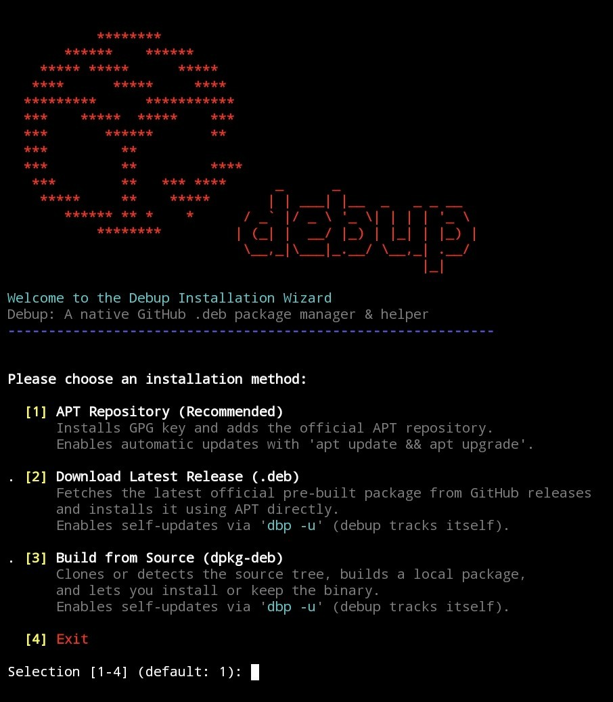

<div align="center">
 

<h1>debup</h1>
<p><strong>debup - Gestionnaire de paquets hybride : le pont manquant entre GitHub & APT pour les distributions basées sur Debian/Ubuntu, Raspberry Pi, Docker, WSL & le terminal Linux Android (AVF).</strong></p>
<p>Recherchez, découvrez, suivez, installez et mettez à jour des paquets <code>.deb</code> directement depuis APT & GitHub Releases <strong>simultanément</strong>.</p>
<p><em>Pas de PPA, pas de sandbox lourds, pas de dépôts tiers — uniquement des binaires <code>.deb</code> natifs récupérés directement depuis l'upstream.
Installation facile avec l'<a href="https://github.com/Ruraam/debup#-installation">installeur Debup interactif/non-interactif</a>.</em></p>
  
</div>

<br/>

<div align="center">
<a href="LICENSE"></a> &nbsp;
<a href="https://debian.org"></a> &nbsp;
<a href="#"></a> &nbsp;
<a href="https://www.gnu.org/software/bash/"></a>
</div>

<div align="center">
<a href="https://github.com/Ruraam/debup/releases"></a> &nbsp;
<a href="#"></a> &nbsp;
<a href="https://github.com/Ruraam/debup/releases"></a>
</div>

<br/>

<div align="center">

<a href="README.md"> English</a> &nbsp;•&nbsp;
<a href="README.fr.md"> Français</a> &nbsp;•&nbsp;
<a href="README.es.md"> Español</a>

</div>

<div align="center">

| [Utilisation](https://github.com/Ruraam/debup/tree/main#%EF%B8%8F-utilisation) | [Token GitHub](https://github.com/Ruraam/debup/blob/main/README.fr.md#-configurer-un-token-github-optionnel--dbp-token-) | [Recherche & Installation](https://github.com/Ruraam/debup/tree/main#-découverte-recherche--installation-de-paquets--dbp-search) | [Désinstallation](https://github.com/Ruraam/debup/tree/main#%EF%B8%8F-désinstallation) |
| :---: | :---: | :---: | :---: |
| [Configuration](https://github.com/Ruraam/debup/blob/main/README.fr.md#%EF%B8%8F-configuration) | [Captures d'écran](https://github.com/Ruraam/debup/tree/main#captures-décran) | [Changelog](https://github.com/Ruraam/debup/releases) | [Licence](LICENSE) |
</div>

---
> 🚀 **Découvrez mon nouveau projet :** [**ULPM & .lpk**](https://github.com/Ruraam/ulpm) — *Gestionnaire de paquets conteneurisé léger, sans root, sans démon pour Linux.*

---

##  debup [ `dbp` ] - Le pont manquant entre GitHub & APT

L'ergonomie d'AUR vous manque sur Debian/Ubuntu ? **debup** transforme les GitHub Releases en votre dépôt tiers personnel.
**Découvrez, inspectez, installez et mettez à jour des paquets Debian directement depuis GitHub Releases avec la simplicité d'`apt`.**

## ✨ Fonctionnalités clés

### 🔍 Découverte unifiée & installation multiple [dbp -s <requête>] :

• Recherche simultanément dans les dépôts APT Debian et les GitHub Releases depuis une seule requête terminal, pré-filtrée pour les binaires compatibles.

• Prompt interactif multi-sélection supportant les plages et les listes séparées par des virgules (ex. 1 2 3, 1-3, 1,2,4) pour des installations groupées rapides.

#### 📦 Installation directe [dbp -i <owner/repo> / dbp -i <paquet>]:

• Plus besoin de chercher les URLs de release. Pointez vers n'importe quel dépôt, debup détecte, associe votre architecture (amd64 / arm64), télécharge et installe le bon .deb.

• Fonctionne aussi de manière transparente avec les paquets APT natifs (dbp -i bat).

• Supporte l'épinglage de version à l'installation : dbp -i owner/repo@vX.Y.Z.

• Supporte les installations automatisées non-interactives via -y / --yes.

#### ℹ️ Aperçu des métadonnées [dbp -f <owner/repo>]:

• Prévisualisez les métadonnées distantes avant de toucher votre système (nombre d'étoiles, licence SPDX, description, tag de release, date de publication et compatibilité d'architecture des assets).

#### 🛡️ Audit de sécurité & inspection des scripts root [dbp -I <owner/repo>]:

• Inspectez les scripts internes du mainteneur (preinst, postinst, prerm, postrm) et l'arborescence brute contenue dans n'importe quel .deb distant avant exécution.

• Prompt interactif automatique vous alertant lorsqu'un paquet téléchargé contient des scripts de maintenance root avant installation.

#### 🔒 Vérification d'intégrité automatisée :

• Détecte et valide automatiquement les fichiers de checksums publiés (SHA256SUMS, checksums.txt, *.sha256) contre les binaires téléchargés avant d'invoquer dpkg.

#### 🔄 Cycle de vie APT natif & mises à jour unifiées [dbp -u]:

• Synchronise les dépôts APT et met à jour à la fois les paquets Debian natifs et les applications GitHub suivies dans un workflow unifié.

• Suppression propre du suivi de paquet [dbp -r <paquet>] avec exécution automatisée du purge APT.

#### 📊 Télémétrie & tableau de bord système [dbp -S]:

• Vue en temps réel des paquets natifs installés, des paquets GitHub suivis, des paquets verrouillés, de l'empreinte du cache API, et du quota restant de l'API GitHub avec l'heure de réinitialisation.

#### 🧹 Maintenance & nettoyage des caches [dbp -c]:

• Nettoie les archives deb d'installation résiduelles dans /tmp, purge le cache de téléchargement d'APT, et réinitialise les caches de réponses locales obsolètes de l'API GitHub.

#### 🧪 Mode simulation Dry-Run [-d / --dry-run]:

• Simulez les téléchargements, mises à jour, opérations sur les dépôts, épinglages et désépinglages sur n'importe quelle commande sans effectuer de changement réel sur le système de fichiers ou l'état APT.

#### ⚡ Suivi & cache API haut débit [dbp -t]:

• Cache local de réponses API pour éliminer les requêtes redondantes et optimiser la bande passante.

• Stockez en toute sécurité un token GitHub personnel (chmod 600) pour débloquer 5 000 req/h pour les recherches lourdes et les vérifications automatiques de mises à jour en arrière-plan.

#### 💻 Bash completion natif :

• Support de l'autocomplétion pour debup et l'alias dbp, avec suggestions dynamiques de paquets contextuelles pour remove, pin et unpin.

#### 🛡️ Épinglage de paquets (apt-mark hold) :

• Figer les mises à jour de paquets : verrouillez des paquets spécifiques à leur version actuelle via la commande pin [dbp -p <paquet>] pour empêcher les mises à jour non désirées.

• Défiger les mises à jour : restaurez les mises à jour automatiques à tout moment avec unpin [dbp -n <paquet>].

• Intégration APT native : s'appuie directement sur le mécanisme apt-mark standard de Debian, garantissant 100 % de cohérence avec les outils système natifs.

### 🎯 Détection intelligente des assets

`debup` sélectionne automatiquement le bon binaire `.deb` depuis les GitHub Releases, sans deviner :

**Architectures flexibles :** associe les noms standard & alias :
* **x86_64 :** `amd64`, `x86_64`, `x86-64`, `x64`, `all`
* **ARM64 :** `arm64`, `aarch64`, `armv8`, `arm64v8`, `all`
* **Protection cross-architecture :** filtre activement les assets conflictuels (ex. empêche de télécharger `arm64` sur une machine `amd64`).
* **Priorisation de distribution :** préfère les builds spécifiques à la distribution (`debian` vs `ubuntu`) lorsque plusieurs paquets compatibles sont publiés.
* **Fallback sécurisé :** abandonne proprement avec un avertissement explicite si aucun paquet compatible n'existe pour votre architecture CPU.

---

## 📦 Installation

### ⚡ Installation rapide interactive/non-interactive
**Installeur Zero-Trust :** intègre une validation automatique fail-closed de l'empreinte GPG, une vérification d'intégrité SHA-256, et un support complet pour les prompts interactifs et les déploiements headless non-interactifs (`-y` / CI/CD).

Lancez l'assistant d'installation interactif pour choisir votre méthode d'installation préférée (dépôt APT, dernière release, ou build depuis les sources) :
```bash
curl -sSL https://raw.githubusercontent.com/Ruraam/debup/main/installer.sh | bash
```
&nbsp;

Lancez avec le flag `-y` pour des installations entièrement automatisées (par défaut sur la méthode recommandée du dépôt APT, sans prompts) :
```bash
curl -sSL https://raw.githubusercontent.com/Ruraam/debup/main/installer.sh | bash -s -- -y
```
<div align="center">

 
</div>

---

### 🔑 Configurer un token GitHub (optionnel) [ `dbp token` ]

Par défaut, GitHub limite les requêtes anonymes à 60 requêtes/heure. Ajouter un token augmente cette limite à 5000 requêtes/heure.

**1. Générez un token :**
Allez sur GitHub > Settings > Developer settings > Personal access tokens > Tokens (classic) > Generate new token (aucun scope/permission nécessaire, laissez tout décoché).

**2. Associez-le à debup :**
```bash
dbp token <ghtoken>
```
`debup` le détectera et l'utilisera automatiquement, augmentant votre limite à 5 000 requêtes par heure.

> ***🔒 Note de sécurité :***
> - **Stockage au niveau utilisateur (par défaut) :** le token est écrit dans `${XDG_CONFIG_HOME:-$HOME/.config}/debup/token` avec `chmod 600`. Aucune élévation requise — `debup` fonctionne entièrement en tant qu'utilisateur normal.
> - **Stockage au niveau root (optionnel) :** si `debup` est invoqué en root, le token est également dupliqué dans `/etc/debup/debup.conf` avec `chmod 600`, pour une disponibilité système.
> - Dans les deux cas, seul le propriétaire du fichier (ou root) peut le lire.

---

## 🛠️ Utilisation

### Gestion des paquets
**Ajouter un dépôt pour installer un `.deb` & le suivre :**
```bash
dbp -a <owner>/<repo>
```
par exemple :
```bash
dbp -a Ruraam/Uraam
```

**Lister les dépôts suivis**
```bash
dbp -l
```
**Supprimer un dépôt suivi**
```bash
dbp -r <nom-du-paquet>
```

**Empêcher une application de se mettre à jour**
```bash
dbp -p <nom-du-paquet>
```
**Autoriser une application à se mettre à jour à nouveau**
```bash
dbp -n <nom-du-paquet>
```


### Mises à jour/Upgrade des paquets
**Télécharger et mettre à jour les paquets suivis avec confirmation (avec & sans dépôt APT)**
```bash
dbp -u [-y]
```
**Mettre à jour debup via le dépôt APT :**
```bash
sudo apt update && sudo apt upgrade debup
```

### 🔄 Vérification rapide des mises à jour (action par défaut)

Lancer `dbp` **sans argument** déclenche une vérification rapide et non destructive des mises à jour sur les dépôts APT et les paquets GitHub suivis :

```bash
dbp
```

Cela se comporte exactement comme `dbp update` (ou `dbp -v`) et affiche un résumé unifié :

- Nombre de paquets APT pouvant être mis à jour
- Nombre de paquets GitHub suivis avec une release plus récente
- Une suggestion d'exécuter `dbp upgrade` pour appliquer les changements

Pas de prompts, pas d'installation — un coup d'œil rapide sur l'état. Parfait pour cron, les hooks MOTD, ou une vérification rapide avant `dbp -u`.

### 🛡️ Audit & Inspection

Inspectez les scripts du mainteneur (`preinst`, `postinst`, `prerm`, `postrm`) et le contenu du paquet **avant** installation :

```bash
dbp -I <owner>/<repo>
```

Utile pour vérifier ce qu'un `.deb` fera à votre système avant de lui faire confiance.

### 🧪 Simulation Dry-Run

Prévisualisez n'importe quelle action sans modifier votre système :

```bash
dbp -u -d
dbp -i <owner>/<repo> --dry-run
```

Supporte toutes les commandes destructives : `install`, `upgrade`, `remove`, `pin`, `unpin`, `clean`.

### 🧹 Nettoyage système

Purge les caches APT et les caches de réponses obsolètes de l'API GitHub :

```bash
dbp -c
```

Libère de l'espace disque et élimine les requêtes réseau redondantes pour les prochaines opérations.

### 🔍 Découverte, recherche & installation de paquets [ `dbp search`] 

Trouvez & découvrez n'importe quel projet GitHub fournissant des paquets .deb compatibles avec votre architecture et installez-le en un clic :
Prévisualisez les informations du dépôt :
```bash
dbp -f <owner>/<repo>
```
##### Exemple : dbp -f Ruraam/Uraam

```bash
dbp -s <mot-clé>
```
##### Exemple : [ `dbp -s uraam`] 
**Comment ça fonctionne :**

Entrez le numéro du paquet dans la liste et appuyez sur Entrée. debup télécharge le .deb correspondant, l'installe via apt, et l'ajoute automatiquement à votre liste de suivi pour les futures mises à jour.

<p align="center">
  </p>

---

## Alias courts des flags CLI : flags POSIX single-letter standard pour des workflows terminal rationalisés :
[-a : add / install] [-u : update / upgrade] [-r : remove] [-p : pin] [-n : unpin] [-s : search] [-f : info / show] [-I : inspect / audit] [-l : list] [-t : token / auth] [-S : stats] [-c : clean] [-d : dry-run]

---

## ⚙️ Configuration

**Les sources suivies sont stockées dans :** `/etc/debup/sources.list`

**Format :** `<nom-du-paquet>|<utilisateur-github>/<dépôt-github>`

**Le token GitHub est stocké dans :**
- `${XDG_CONFIG_HOME:-$HOME/.config}/debup/token` (niveau utilisateur, par défaut)
- `/etc/debup/debup.conf` (niveau root, lorsque `debup` est lancé en root)

---

## 🗑️ Désinstallation
**Supprimer le paquet (sudo)**
```bash
dbp -r debup [-y]
```
Prompté pour la configuration du purge ou non.

ou
```bash
sudo apt remove debup [-y]
```
**Supprimer le paquet et nettoyer la configuration**
```bash
sudo apt --purge debup [-y]
```

---

## Captures d'écran
<p align="center">
   </p>

---

## 📄 Licence

Ce projet est sous licence [GNU General Public License v3.0](LICENSE).

---

*[Universal Linux Package Manager [ULPM] :](https://github.com/Ruraam/ulpm) 3⭐ - Runtime `application/OS read-only` sandboxé, léger, sans root, sans démon, pour toute distribution Linux. Plus léger que Flatpak ou Snap.*

*[Universal Ruvomain ADB App Manager [URAAM] :](https://github.com/Ruraam/Uraam) 50⭐ - Une boîte à outils shell tout-en-un pour le `débloatage Android`. Désinstallez/désactivez vos applications, sauvegardez votre fichier JSON de débloat & restaurez, installez des APK. Fonctionne avec `Termux WirelessADB, Shizuku, Root`, `Linux Debian, Arch, Fedora, macOS & WSL`. Compatible avec les listes JSON Canta/UAD.*

---

*Fait avec 🐧 Debian, ☕ café, et une quantité déraisonnable de `bash -n`.*
