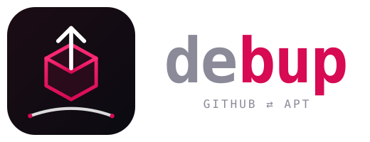
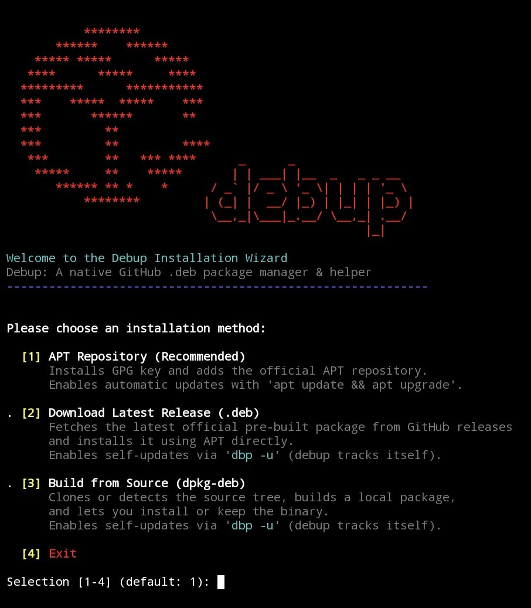

<div align="center">


<p><strong>debup - Hybrid Package Manager: The missing bridge between GitHub & APT for Debian/Ubuntu-based distributions, Raspberry Pi, Docker, WSL & Android Linux Terminal (AVF).</strong></p>
<p>Search, discover, track, install, and upgrade <code>.deb</code> packages directly from APT & GitHub Releases <strong>simultaneously</strong>.</p>
<p><em>No PPAs, no bloated sandboxes, no third-party repositories — just native <code>.deb</code> binaries fetched straight from upstream.
Easy installation with <a href="https://github.com/Ruraam/debup#-installation">interactive/non-interactive Debup Installer</a>.</em></p>
  
</div>

<br/>

<div align="center">
<a href="LICENSE"></a> &nbsp;
<a href="https://debian.org"></a> &nbsp;
<a href="#"></a> &nbsp;
<a href="https://www.gnu.org/software/bash/"></a>
</div>

<div align="center">
<a href="https://github.com/Ruraam/debup/releases"></a> &nbsp;
<a href="#"></a> &nbsp;
<a href="https://github.com/Ruraam/debup/releases"></a>
</div>

<br/>

<div align="center">

<a href="README.md"> English</a> &nbsp;•&nbsp;
<a href="README.fr.md"> Français</a> &nbsp;•&nbsp;
<a href="README.es.md"> Español</a>

</div>

<div align="center">

<!-- CORRIGÉ #2 : "optionnal" → "optional" -->
| [Usage](https://github.com/Ruraam/debup/tree/main#%EF%B8%8F-usage) | [GitHub Token](https://github.com/Ruraam/debup/blob/main/README.md#-configure-a-github-token-optional--dbp-token-) | [Search & Install](https://github.com/Ruraam/debup/tree/main#-discover-search--install-packages--dbp-search) | [Uninstallation](https://github.com/Ruraam/debup/tree/main#%EF%B8%8F-uninstallation) |
| :---: | :---: | :---: | :---: |
| [Configuration](https://github.com/Ruraam/debup/blob/main/README.md#%EF%B8%8F-configuration) | [Screenshots](https://github.com/Ruraam/debup/tree/main#screenshots) | [Changelog](https://github.com/Ruraam/debup/releases) | [License](LICENSE) |
</div>

---
> 🚀 **Check out my new project:** [**ULPM & .lpk**](https://github.com/Ruraam/ulpm) — *Lightweight, rootless, zero-daemon containerized package manager for Linux.*

---

##  **debup** [ `dbp` ] - The Missing Bridge Between GitHub & APT

Missing the AUR convenience on Debian/Ubuntu? **debup** turns GitHub Releases into your personal rolling third-party repository.
**Discover, inspect, install, and update Debian packages directly from GitHub Releases with the simplicity of `apt`.**

## ✨ Core Features

### 🔍 Unified Discovery & Multi-Install [dbp -s <query>] :

• Search Debian APT repositories and GitHub Releases concurrently in a single terminal query, pre-filtered for compatible binary packages.

• Interactive multi-selection prompt supporting ranges and comma-separated lists (e.g., 1 2 3, 1-3, 1,2,4) for rapid batch installations.

#### 📦 Direct Installation [dbp -i <owner/repo> / dbp -i <pkg>]:

• No need to hunt down release URLs. Point to any repository, and debup detects, matches your architecture (amd64 / arm64), downloads, and installs the right .deb.

• Works transparently with native APT packages as well (dbp -i bat).

• Supports version pins on installation: dbp -i owner/repo@vX.Y.Z.

• Supports non-interactive automated installs via -y / --yes.

#### ℹ️ Metadata Preview [dbp -f <owner/repo>]:

• Preview remote package metadata before touching your system (stars count, SPDX license, description, release tag, publish date, and architecture asset compatibility).

#### 🛡️ Security Audit & Root Script Inspection [dbp -I <owner/repo>]:

• Inspect internal maintainer scripts (preinst, postinst, prerm, postrm) and the raw file tree contained inside any remote .deb before execution.

• Automatic interactive prompt alerting you whenever a downloaded package contains root maintenance scripts prior to installation.

#### 🔒 Automated Integrity Verification:

• Automatically detects and validates published checksum files (SHA256SUMS, checksums.txt, *.sha256) against downloaded binaries before invoking dpkg.

#### 🔄 Native APT Lifecycle & Unified Upgrades [dbp -u]:

• Seamlessly syncs APT repositories and updates both native Debian packages and tracked GitHub applications in a single unified workflow.

• Clean package tracking removal [dbp -r <pkg>] with automated APT purge execution.

#### 📊 Telemetry & System Dashboard [dbp -S]:

• Real-time overview of native installed packages, tracked GitHub packages, locked packages, API cache footprint, and remaining GitHub API rate-limit quota with reset time.

#### 🧹 Maintenance & Cache Cleanup [dbp -c]:

• Cleans leftover installation deb archives in /tmp, purges APT's download cache, and resets stale local GitHub API response caches.

#### 🧪 Dry-Run Simulation Mode [-d / --dry-run]:

• Simulate downloads, upgrades, repository operations, pins, and unpins across any command without making any actual changes to the file system or APT state.

#### ⚡ High-Rate API Tracking & Caching [dbp -t]:

• Local API response cache to eliminate redundant requests and optimize bandwidth.

• Securely store a personal GitHub token (chmod 600) to unlock 5,000 req/h for heavy searches and automated background update checks.

#### 💻 Native Bash completion:

• Autocompletion support for both debup and the dbp alias, featuring context-aware dynamic package suggestions for remove, pin, and unpin.

#### 🛡️ Package Pinning (apt-mark hold):

• Freeze package updates: Lock specific packages to their current version using the pin [dbp -p <pkg>] command to prevent unwanted updates.

• Unfreeze updates: Restore automatic updates anytime with unpin [dbp -n <pkg>].

• Native APT integration: Relies directly on Debian's standard apt-mark mechanism under the hood, ensuring 100% consistency with native system tools.

### 🎯 Smart Asset Detection

`debup` automatically picks the right `.deb` binary from GitHub Releases without guesswork:

**Flexible Architectures:** Matches standard & alias names:
* **x86_64:** `amd64`, `x86_64`, `x86-64`, `x64`, `all`
* **ARM64:** `arm64`, `aarch64`, `armv8`, `arm64v8`, `all`
* **Cross-Architecture Protection:** Actively filters out conflicting assets (e.g., prevents downloading `arm64` on `amd64` machines).
* **Distro Prioritization:** Prefers distro-specific builds (`debian` vs `ubuntu`) when multiple compatible packages are published.
* **Safe Fallback:** Cleanly aborts with an explicit warning if no compatible package exists for your CPU architecture.

---

## 📦 Installation

### ⚡ Quick Interactive/Non-Interactive Setup
**Zero-Trust Installer:** Features automated fail-closed GPG fingerprint validation, SHA-256 integrity verification, and full support for both interactive prompts and headless non-interactive deployments (`-y` / CI/CD).

Run the interactive installer wizard to choose your preferred setup method (APT Repository, Latest Release, or Build from source):
```bash
curl -sSL https://raw.githubusercontent.com/Ruraam/debup/main/installer.sh | bash
```
&nbsp;

Run with the `-y` flag for fully automated setups (defaulting to the recommended APT repository method without prompts):
```bash
curl -sSL https://raw.githubusercontent.com/Ruraam/debup/main/installer.sh | bash -s -- -y
```
<div align="center">

 
</div>

---

### 🔑 Configure a GitHub Token (optional) [ `dbp token` ]

By default, GitHub limits anonymous requests to 60 requests/hour. Adding a token increases this limit to 5000 requests/hour.

**1. Generate a token:**
Go to GitHub > Settings > Developer settings > Personal access tokens > Tokens (classic) > Generate new token (no scopes/permissions needed, leave everything unchecked).

**2. Link it to debup:**
```bash
dbp token <ghtoken>
```
`debup` will automatically detect and use it, boosting your limit to 5,000 requests per hour.

<!-- CORRIGÉ #1 : localisation réelle du token (user-level d'abord, root-level en duplication) -->
> ***🔒 Security Note:***
> - **User-level storage (default):** the token is written to `${XDG_CONFIG_HOME:-$HOME/.config}/debup/token` with `chmod 600`. No elevation required — `debup` works fully as a regular user.
> - **Root-level storage (optional):** if `debup` is invoked as root, the token is also duplicated to `/etc/debup/debup.conf` with `chmod 600`, for system-wide availability.
> - In both cases, only the owning user (or root) can read the file.

---

## 🛠️ Usage

### Package Management
**Add a repository to install `.deb` & track:**
```bash
dbp -a <owner>/<repo>
```
for example:
```bash
dbp -a Ruraam/Uraam
```

**List tracked repositories**
```bash
dbp -l
```
**Remove a tracked repository**
```bash
dbp -r <package-name>
```

**Prevent an app from updating**
```bash
dbp -p <package-name>
```
**Allow an app to update again**
```bash
dbp -n <package-name>
```


### Package Updates/Upgrade
**Download and upgrade tracked packages with confirmation (with & without APT repository)**
```bash
dbp -u [-y]
```
**Update debup via APT repository:**
```bash
sudo apt update && sudo apt upgrade debup
```

<!-- CORRIGÉ #1 (suite) : comportement par défaut de `dbp` sans argument -->
### 🔄 Quick Update Check (default action)

Running `dbp` with **no argument** triggers a fast, non-destructive update check across both APT repositories and tracked GitHub packages:

```bash
dbp
```

This behaves exactly like `dbp update` (or `dbp -v`) and prints a unified summary:

- Number of upgradable APT packages
- Number of tracked GitHub packages with a newer release
- A hint to run `dbp upgrade` to apply changes

No prompts, no installation — a one-glance status check. Perfect for cron, MOTD hooks, or a quick sanity check before `dbp -u`.

<!-- CORRIGÉ #3 : section Audit / Dry-run / Cleanup ajoutée -->
### 🛡️ Audit & Inspection

Inspect maintainer scripts (`preinst`, `postinst`, `prerm`, `postrm`) and package contents **before** installation:

```bash
dbp -I <owner>/<repo>
```

Useful to verify what a `.deb` will do to your system before trusting it.

### 🧪 Dry-Run Simulation

Preview any action without modifying your system:

```bash
dbp -u -d
dbp -i <owner>/<repo> --dry-run
```

Supported on every destructive command: `install`, `upgrade`, `remove`, `pin`, `unpin`, `clean`.

### 🧹 System Cleanup

Purge APT caches and stale GitHub API response caches:

```bash
dbp -c
```

Frees disk space and eliminates redundant network requests for the next operations.

### 🔍 Discover, Search & Install Packages [ `dbp search`] 

Find & discover any GitHub project providing .deb packages compatible with your architecture and install it in one click:
Preview repository information:
```bash
dbp -f <owner>/<repo>
```
##### Example: dbp -f Ruraam/Uraam

```bash
dbp -s <keyword>
```
##### Example: [ `dbp -s uraam`] 
**How it works:**

Enter the package number from the list and press Enter. debup downloads the matching .deb, installs it via apt, and automatically adds it to your tracking list for future updates.

<p align="center">
  </p>

---

## Short CLI flag aliases: Standard single-letter POSIX flags for streamlined terminal workflows:
[-a : add / install] [-u : update / upgrade] [-r : remove] [-p : pin] [-n : unpin] [-s : search] [-f : info / show] [-I : inspect / audit] [-l : list] [-t : token / auth] [-S : stats] [-c : clean] [-d : dry-run]

---

## ⚙️ Configuration

**Tracked sources are stored in:** `/etc/debup/sources.list`

**Format:** `<package-name>|<github-user>/<github-repo>`

**GitHub Token is stored in:**
- `${XDG_CONFIG_HOME:-$HOME/.config}/debup/token` (user-level, default)
- `/etc/debup/debup.conf` (root-level, when `debup` is run as root)

---

## 🗑️ Uninstallation
**Remove package (sudo)**
```bash
dbp -r debup [-y]
```
Prompted for purge configuration or not.

or
```bash
sudo apt remove debup [-y]
```
**Remove package and clean configuration**
```bash
sudo apt --purge debup [-y]
```

---

## Screenshots
<p align="center">
   </p>

---

## 📄 License

This project is licensed under the [GNU General Public License v3.0](LICENSE).

---

## 🛠️ Related Projects

* [**BubbleOS**](https://github.com/Ruraam/Bubbleos)  [](https://github.com/Ruraam/Bubbleos/stargazers) — BubbleOS is an experimental Linux operatingsystem built around the Linux kernel and the ULPM/LPK ecosystem.

*  [**Universal Linux Package Manager [ULPM]**](https://github.com/Ruraam/ulpm)  [](https://github.com/Ruraam/ulpm/stargazers) —Lightweight, rootless, zero-daemon, sandboxed `application/read-only OS runtime` for any Linux distribution. Lighter thanFlatpak or Snap.

* [**Universal Ruvomain ADB App Manager [URAAM]**](https://github.com/Ruraam/Uraam)  [](https://github.com/Ruraam/Uraam/stargazers) — An all-in-one shell toolkit for `Android debloating`. Uninstall/disable your apps, backup your debloat apps JSON file& revert/restore, install apk. Works with `Termux WirelessADB, Shizuku, Root`, `LinuxDebian, Arch, Fedora, macOS & WSL`. Compatible with Canta/UAD JSON lists.

---

*Made with 🐧 Debian, ☕ coffee, and an unreasonable amount of `bash -n`.*
